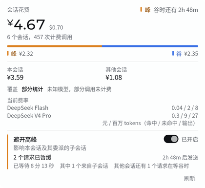
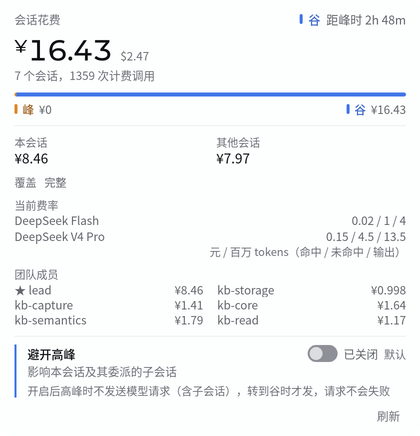

<h1 align="center">dsh-api-cost</h1>

<p align="center">Know what every DeepSeek call costs — and skip the expensive half.</p>

<p align="center">
  <a href="https://github.com/NIRVANA-APOC/dsh-api-cost/actions/workflows/test.yml"></a>
  <a href="https://www.npmjs.com/package/dsh-api-cost"></a>
  
  
</p>

<p align="center"><b>English</b> · <a href="README.md">中文</a></p>

---

<p align="center"></p>

<p align="center"><i>One session at peak: what it spent, where the money went, how long until it is cheap, and how many requests in this conversation tree are waiting for off-peak.</i></p>

## Why dsh-api-cost

`dsh-api-cost` is a cost meter for DeepSeek Harness: the host folds every settled call into one pure `apiCost` session projection and tells you what this session, this delegation tree and this team each spent. It is not a log aggregator — it does not replay logs or keep a second ledger; the numbers come straight from the host's event stream and durable checkpoint.

- **Peak or off-peak at a glance** — the pill writes the tier as the word 峰 or 谷; the panel header adds the current tier and the countdown to the next switch, and an amber/blue band splits the spend into the expensive half and the cheap half.
- **Avoid peak** — while the switch is on and the tier is peak, the model requests of this session and the child sessions it delegates to are parked and then sent unchanged once off-peak begins: up to half the price, with the model none the wiser.
- **Correct settlement semantics** — projection-first: one settlement per `assistant/message`, priced at its own settlement instant; a forked child's own figure excludes the inherited prefix; a resumed history folds from the durable log rather than starting at ¥0 or double counting.
- **Clear attribution** — `self` / `tree` / `team` scopes; the team roster lists one money figure per member with the Lead marked ★; `others` is always `total − own`, so a fork is never counted twice.
- **Light** — no replay framework, no database, no polling loop of its own: about **13.7 KiB gzip** on the client and **15.3 KiB gzip** on the host.
- **Honest** — an estimate, not a bill; models outside the rate card are marked unpriced instead of guessed; coverage gaps are written out in words.

**Why it is not another usage panel.** Usage panels typically replay logs plugin-side and keep a ledger of their own. `dsh-api-cost` registers a host-owned `apiCost` session projection — event drive, per-session watermark and durable checkpoint all belong to the Harness — and the client reads the same projection through the framework's own `useProjection` seat. The difference is structural: history never has to be backfilled and a restart cannot double the figure; `tree` / `team` attribution reuses the durable delegation catalog and team roster, the fork-inherited prefix is explicitly excluded, and looking at a branch never counts its ancestors twice.

## Install

Requires DeepSeek Harness **0.2.0-rc.2+** (verified on **0.2.2-rc.2**) with the `sessionProjections`, `sessionProjectionCache` and `sessionQuery` capabilities mounted (the shipped `web` and `desktop` profiles have them). The repository ships a prebuilt `dist/` — **installation never runs a compiler**; Node.js 24 is needed only for development.

```sh
# Web / CLI profile — install from the GitHub repository (works today)
dsh plugin --profile web add github:NIRVANA-APOC/dsh-api-cost

# Desktop profile
dsh plugin --profile desktop add github:NIRVANA-APOC/dsh-api-cost
```

For the desktop app, **fully quit** DSH before running the install command (on Windows, quit from the tray icon — closing the window leaves a process lock), then reopen it; if the desktop app has not registered the `dsh` command yet, install it once from its **Manage dsh Command → Install** menu. The web build can also run `npx @deepseek-ai/dsh plugin --profile web add github:NIRVANA-APOC/dsh-api-cost`. A GitHub-source install needs a working `git` on the machine (pnpm fetches the repository with git); 2.3.0 is published on npm as well, so `dsh plugin --profile web add dsh-api-cost` installs the same package without git (published with provenance by the repository's release workflow — see [docs/releasing.md](docs/releasing.md)). Host-side features (the projection, `/cost`, `session_cost`, the HTTP reads) take effect immediately; the composer pill is composed client-side at startup, so **restart DSH once**.

## What you see

### The pill

Beside the shipped session-stats pills, it sits quietly by the composer: this session's estimate, a hairline divider, and the tier written as the word 峰 / 谷 in that tariff's colour — a word, never colour alone. The number reads the host projection and repaints when a settlement lands rather than on a timer; a partial-coverage marker appears whenever a contributing session is unpriced, truncated or unreadable; and while requests are parked the pill adds the words 等待谷时 plus how many are waiting (`×2`).

| Off-peak | Peak |
| --- | --- |
|  |  |

### The panel

Clicking the pill (or pressing Enter on it) opens the detail panel. It is organised around the two tariffs rather than around a row list:

- the header carries the current tier and the countdown to the next switch — when it is cheap matters as much as what was spent;
- the session's estimate is the visual centre, set in the app's brand face with the officially published USD column beside it and the scope's counts beneath;
- a peak/off-peak band splits the spend into amber and blue, each end labelled with its own amount and the word 峰 / 谷;
- then the this-session / other-session split, the coverage state with every caveat written out, and the rates in force with their unit line;
- a tree-scoped Avoid-peak block: the switch, a scope line, and the hold state — how many requests in the tree are parked (and how many of those come from child sessions), when they will be released, how long they have waited, and how many are parked in unrelated other conversations;
- a Refresh button — it re-reads the scope instead of replaying logs.

Token buckets and the per-model breakdown are deliberately not on the panel; they remain available through `/cost`, `session_cost` and `detail=full`.

### Command and tool

| Surface | Behaviour |
| --- | --- |
| `/cost [sessionId] [auto\|self\|tree\|team]` | Prints the same summary the pill shows, including coverage warnings. |
| `session_cost` | Lets the assistant read a session's estimate; defaults to the calling session. |

## Scopes

The default `auto` shows the whole verified team when it can be verified, otherwise your own delegation tree; `self` / `tree` / `team` pin the scope.

| Scope | Meaning |
| --- | --- |
| `auto` (default) | The verified team for a team member, otherwise this session's delegation tree. |
| `self` | This session only. |
| `tree` | This session plus every durable subagent descendant. |
| `team` | The whole team: Lead, members and their descendants; an unverifiable membership is an error, not a pretend success. |

The `team` scope lists every member's own amount under **Team roster**, with the Lead marked ★:



## Avoiding peak hours

A peak window costs twice the off-peak rate: Flash is ¥2 cache-miss / ¥8 output per million tokens during peak against ¥1 / ¥4 off-peak; V4 Pro is ¥9 / ¥27 against ¥4.5 / ¥13.5. If a request does not have to be answered right *now*, it does not have to be billed at the expensive rate.

### One switch, one conversation tree

Every session's panel has an **Avoid peak** switch, off by default. While it is on and the tier is peak, the model requests issued by this session and the child sessions it delegates to are all parked and released unchanged the moment the tier turns off-peak. The scope is one conversation tree, not the whole process: another conversation is never held up because this one is waiting. A delegated subagent follows its parent unless its own panel was switched by hand — the nearest manual choice wins: this session's own choice if it has one, otherwise the nearest ancestor that does, otherwise the configured default. This is a user choice per session, persisted by the host, so every session's position survives a restart; a conversation tree that was never switched inherits the configured default.

### The model feels "slow", not "broken"

The key question is what the model sees: **nothing**. The gate sits on the `llm/stream` waterfall, before any provider dispatch, so no failure is reported, no error is appended to the session log, no retry is consumed and no chunk is injected. The request itself is not changed by a single byte — same messages, same tools — so you get the same answer, only billed off-peak. From the loop's point of view the call was simply slow, and the wait is visible only in the pill and the panel: the current tier, the countdown to off-peak, how many requests in the tree are waiting (and how many are child-session requests), and how long they have waited.

### Holds, never splits; fails open

It does not split a call: a request already in flight when peak begins is unaffected, and a call issued off-peak that settles during peak is still billed at peak, because settlement time decides the rate. But any internal failure — an unreadable clock, an unreadable tier, a timer that will not arm — releases the request immediately; the failure mode of this feature is "you paid peak prices", never "your session is stuck". Turning a session's switch off, pressing stop, or unloading the plugin immediately releases the requests that are actually waiting.

## Rates

Published DeepSeek prices, in force from 2026-09-10 12:00 +08:00 (CNY per million tokens):

| Model | Period | Cache hit | Cache miss | Output |
| --- | --- | --- | --- | --- |
| `deepseek-flash` | peak | 0.04 | 2 | 8 |
| `deepseek-flash` | off-peak | 0.02 | 1 | 4 |
| `deepseek-v4-pro` | peak | 0.30 | 9 | 27 |
| `deepseek-v4-pro` | off-peak | 0.15 | 4.5 | 13.5 |

The panel's $ column is computed from DeepSeek's separately published USD prices, never from a guessed exchange rate. Peak is Beijing time Monday–Friday 09:00–12:00 and 14:00–18:00 (statutory holidays excluded); nights, weekends, holidays and 调休 makeup workdays are all off-peak. Amounts accumulate in exact integer arithmetic (nano-units) and only round for display; a year missing from the holiday table is priced **off-peak** and marked `holiday-data-missing`.

## Configuration

Add it to your profile patch — usually only these lines are needed:

```yaml
- id: dsh-api-cost
  name: 'dsh-api-cost'
  config:
    defaultScope: auto    # auto | self | tree | team
    tool: true            # register session_cost
    command: true         # register /cost
    gate:                 # per-tree Avoid peak; every session's panel has a switch
      enabled: false      # default position for a session never switched by hand
      persist: true       # keep every session's position across restarts
      models: all         # all | priced
```

The full configuration reference (holiday calendar, `gate.path`, the `gate.models` trade-off and more) is in [docs/configuration.md](docs/configuration.md).

## Honest limits

- **An estimate, not a bill.** Only the official rate card and reported token counts are used; grants, discounts, real retry charges and third-party routing are invisible here.
- **Only official DeepSeek models are priced.** An unknown id is recorded as `unknown-model` with zero money, not guessed.
- **Priced at settlement time.** A call that crosses a window is not split proportionally to elapsed time, because the official docs define no such split.
- **Unreadable sessions are reported as-is.** They are marked `session-unavailable` with `coverage.status = partial`; a traversal that exceeds the 400-session budget is marked `scope-truncated`.
- **Malformed usage reports are never billed.** The call counts as one settlement and is flagged `invalid-usage` / `missing-usage`; no money and no tokens are booked.
- **Avoid peak holds, it does not split.** Requests already in flight are unaffected; a call issued off-peak that settles at peak is still billed at peak.

The full list and definitions are in [docs/limitations.md](docs/limitations.md).

## Documentation

| Document | Contents |
| --- | --- |
| [docs/off-peak-gate.md](docs/off-peak-gate.md) | The gate's frozen interface and the reasoning behind each clause |
| [docs/verification-gate.md](docs/verification-gate.md) | Claim-by-claim verification record for the gate (with falsification runs) |
| [docs/http-api.md](docs/http-api.md) | HTTP routes, parameters and errors |
| [docs/configuration.md](docs/configuration.md) | Full configuration reference |
| [docs/limitations.md](docs/limitations.md) | Estimate boundaries and what is reported as-is |
| [docs/development.md](docs/development.md) | Development commands and the size/performance budget gates |
| [docs/migration-1x.md](docs/migration-1x.md) | Migrating from 1.x to 2.x |
| [docs/releasing.md](docs/releasing.md) | How to publish to npm |

Development commands `pnpm typecheck && pnpm test && pnpm bench` are in [docs/development.md](docs/development.md).

## License

MIT — see [LICENSE](LICENSE).

[](https://github.com/deepseek-ai/deepseek-harness)
