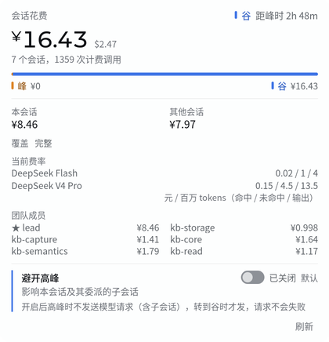

<h1 align="center">dsh-api-cost</h1>

<p align="center">DeepSeek Harness 的 DeepSeek 成本估算：峰谷计价、归集到发起会话的委派与团队花费，由宿主会话投影折叠得出。</p>

<p align="center">
  <a href="https://github.com/NIRVANA-APOC/dsh-api-cost/actions/workflows/test.yml"></a>
  
  
</p>

<p align="center"><a href="README.en.md">English</a> · <b>中文</b></p>

---

`dsh-api-cost` 2.x 采用**以投影为核心的 TypeScript 设计**。它不再自己监听流、重放日志、按时轮询，而是注册一个纯会话投影；事件驱动、每会话水位、持久化检查点与浏览器投递都由 Harness 负责。客户端半边通过框架自带的 `useProjection` 座位直接读取宿主投影。

这样得到的好处：

- **历史不用手动补，也不会重复计** —— 第一次读取某个会话、恢复旧会话或重启之后再进来，都是从持久日志经宿主检查点缓存折叠得出，不会从 ¥0 起算，也不会翻倍。
- **真实的结算语义** —— 每个 `assistant/message`（缺失时回退到 `assistant/attempt`）计一次，按事件**自身结算时刻**定价，fork 继承的前缀不计入子会话自身花费。
- **如实的委派与团队** —— `self`、`tree`、`team` 三个范围分别由持久子智能体目录与团队名单解析；`own` 永远指**本会话**，`others = total − own`。
- **按会话树生效的「避开高峰」开关** —— 每个会话的面板都有一个开关；开启且当前处于高峰时，暂缓**本会话及其委派的子会话**发出的模型请求，等到谷时再发，于是按谷时计价，而模型全程无感。它只作用于这一棵会话树：另一个对话不会因为你在这里等谷时被一起停住。
- **结构上就轻** —— 没有重放框架、没有数据库、没有自有轮询循环。产物体积：客户端约 **13.7 KiB gzip**，宿主约 **15.0 KiB gzip**。

**目录：** [运行要求](#运行要求) · [安装](#安装) · [用法](#用法) · [避开高峰](#避开高峰) · [HTTP](#http) · [费率](#费率) · [配置](#配置) · [它不承诺什么](#它不承诺什么) · [开发](#开发) · [从 1.x 迁移](#从-1x-迁移) · [许可](#许可)

## 运行要求

- DeepSeek Harness **0.2.0-rc.2**，且已装配 `sessionProjections`、`sessionProjectionCache`、`sessionQuery` 三项能力（自带的 `web` 与 `desktop` profile 都有）。
- 仅开发时需要 Node.js **24** 或更高；发布的包里已是预编译 JavaScript。

插件在 `inject` 里声明这些服务，缺少它们的组合里它会保持未激活，而不是半途失效。按会话树生效的「避开高峰」另外用到 `llm` 服务的 `llm/stream` 瀑布；没有 `llm` 的组合只是无处可缓，其余功能照常。

## 安装

```sh
dsh plugin --profile web add dsh-api-cost                # 从 npm
dsh plugin --profile web add /absolute/path/to/checkout  # 从仓库或 git 地址
```

包内已带 `dist/index.js`（ESM 宿主）与 `dist/client.js`（懒加载浏览器工厂），所以**安装过程不需要编译器**。从本地源码目录安装时，需要作者先执行一次 `pnpm build`。

宿主侧能力（投影、`/cost`、`session_cost`、HTTP 读取）立即生效；输入框那枚胶囊要等启动时合成客户端包，所以**需要重启 DSH 一次**。

## 用法

### 胶囊

和官方的会话统计胶囊并排，它安静地待在原地：本会话估算花费、一条细分隔线，以及写成文字的时段**峰** / **谷**（用该时段的计价色，但从不只靠颜色区分）。本会话金额直接读取宿主投影，因此在结算发生时重绘，而不是靠定时器。只要范围内有未定价、被截断或读不到的会话，就会出现「部分统计」标记；有请求在等待时，胶囊再加上「等待谷时」几个字，并在放得下时带上正在等待的数量（`×2`）。

| 空闲 | 高峰 |
| --- | --- |
|  |  |

### 明细面板

点击胶囊（或对它按回车）弹出锚定在触发器上方的对话框；2.2 起它围绕两种计价方式组织，而不是一张行列表：

- 顶栏写当前时段，以及距下次切换的倒计时——什么时候便宜，和花了多少同样重要；
- 本会话的估算花费是视觉重心，用应用的品牌字体书写，旁边是美元列，下面是该范围的统计数字；
- 一条**峰谷条**把这笔钱按高峰与空闲切开——琥珀对蓝，两端各写自己的金额与「峰 / 谷」二字——不看数字也能先读出这笔花费的时段构成；
- 接着是本会话 / 其他会话的拆分、覆盖状态（每条口径提示都用文字写出）、当前生效的费率与单位行；
- 一个**对本会话及其子会话生效的避开高峰区块**：开关、一行写明范围的说明，以及等待中的状态——这棵会话树共几个请求已暂缓（含子会话的那部分）、何时放行、已经等了多久，以及**其他会话**（无关对话）里有几个请求在等；
- 一个**刷新**按钮——它重新读取该范围，而不是重放日志。

token 明细与按模型拆分刻意不放进面板，它们仍可通过 `/cost`、`session_cost` 与 `detail=full` 获取。


### 范围

| 范围 | 含义 |
| --- | --- |
| `auto`（默认） | 能验证到团队时用整个团队，否则用自己的委派树。 |
| `self` | 只看本会话。 |
| `tree` | 本会话加全部持久化的子智能体后代。 |
| `team` | 整个团队：Lead、成员及其后代；成员身份无法验证时报错而不是假装成功。 |

`team` 范围会在「团队成员」下列出每个成员自己的金额，Lead 前置 ★：



### 命令与工具

| 出口 | 行为 |
| --- | --- |
| `/cost [sessionId] [auto\|self\|tree\|team]` | 打印与胶囊一致的摘要，包含覆盖告警。 |
| `session_cost` | 让助手自己查询某个会话的估算；不传即当前会话。 |

## 避开高峰

高峰时段的价格是谷时的两倍：DeepSeek Flash 高峰每百万 tokens 缓存未命中 ¥2、输出 ¥8，谷时是 ¥1 / ¥4；V4 Pro 高峰 ¥9 / ¥27，谷时 ¥4.5 / ¥13.5。如果一个请求不是**此刻**必须得到回答，它就不必按贵的那一档计费。

每个会话面板里的**避开高峰**默认关闭；开启后，只要当前处于高峰时段，**本会话及其委派的子会话**发出的模型请求都会被**暂缓**而不是发出，等到时段转为谷时立刻放行。范围是一棵会话树，而不是整个进程：另一个对话不会因为你在这里等谷时而一起停住。子智能体默认跟随上级——除非它自己的面板里被手动切换过；优先级是「最近的一次手动选择」：本会话有手动选择就听本会话的，否则沿上级找到最近的手动选择，再否则用配置里的默认值。子会话的面板会如实显示「继承」，并说明正在跟随上级会话；父面板的等待数字包含子会话的请求，并注明其中多少来自子会话；而真正另一个对话里的等待，会写成「其他会话还有 N 个请求在等谷时」。请求本身没有任何改动——同样的 messages、同样的工具、同样的字节——所以拿到的还是那个回答，只是按半价计费。

关键在于模型看到了什么：**什么都没有**。闸门挂在 `llm/stream` 瀑布上、早于任何 provider 派发，因此不会报告失败、不会往会话日志追加错误、不会消耗重试次数、也不会注入任何 chunk。从循环的视角看，这次调用只是「慢」。整个等待只在胶囊与面板里可见，并且写得很明白：当前时段、距谷时的倒计时、本会话树有几个请求在等待（并注明其中多少来自子会话）、本次已等待多久。有请求在等时，胶囊会多出「等待谷时」四个字——是文字，不只靠颜色。

这个开关是**用户针对某个会话的选择**，所以它不只是配置：面板通过插件自己的路由写入，宿主把**按会话**的位置表存在 `<dsh home>/state/dsh-api-cost/gate.json`，因此重启后每个会话的位置都还在。从未被手动切换过的会话树会继承配置里的默认值，并如实标明自己仍在默认状态；子树里被手动切换过的会话则显示「继承」。面板不会显示宿主没有确认过的状态；写入失败时保留原位置，并在旁边显示错误。

关掉某个会话的开关、按下停止、或卸载插件，都会立即放行真正在等待的请求：关掉只放行这棵会话树里因此解除等待的请求（另有手动选择的子会话保持原样），停止运行或卸载插件放行全部。等待在任何时刻都可取消，也不会比它存在的理由活得更久。

## HTTP

两条只接受 GET 的成本路径，没有配置项，外加闸门的控制路径：

| 路由 | 返回 |
| --- | --- |
| `/dsh-api-cost/v2/view?session=<id>[&scope=…][&detail=summary\|full][&force=1]` | 统一成本视图（带 ETag，`If-None-Match` 命中返回 `304`）。 |
| `/dsh-api-cost/v2/pricing` | 当前时段、下次切换、价目表与出处。 |
| `GET /dsh-api-cost/v2/gate?session=<id>` | 该会话的避开高峰状态（带 ETag，`If-None-Match` 命中返回 `304`）。 |
| `POST /dsh-api-cost/v2/gate` | 请求体 `{"session":"<id>","enabled":boolean}`；翻转该会话的开关，并返回宿主实际存下的视图。 |

`detail=summary` 不下发按模型、名单与最近调用。成本路径只接受 GET，其余方法返回 `405`；未知参数、范围或 detail 返回 `400`；会话不存在返回 `404`；跨站请求返回 `403`；超过 8 秒预算的读取返回 `503`。闸门读取要求恰好一个 `session` 查询参数，缺失或非法返回 `400`；每个会话的视图有自己的 `ETag`，两个会话不会共用同一份缓存状态。

闸门的 `POST` 是全插件唯一的写入面，因此在读取请求体之前就完成校验：`sec-fetch-site` 不在 `same-origin`/`none` 内返回 `403`，请求体不是 `application/json` 返回 `415`，`Origin` 与请求的 `Host` 不一致返回 `403`，请求体不是恰好 `{"session":"<id>","enabled":boolean}` 或超过 4096 字节返回 `400`——会话 id 非法或多了别的键都不会改变任何状态。响应里不含本机路径。

## 费率

DeepSeek 官方公布价格，2026-09-10 12:00 +08:00 起生效（元 / 百万 tokens）：

| 模型 | 时段 | 缓存命中 | 缓存未命中 | 输出 |
| --- | --- | --- | --- | --- |
| `deepseek-flash` | 高峰 | 0.04 | 2 | 8 |
| `deepseek-flash` | 空闲 | 0.02 | 1 | 4 |
| `deepseek-v4-pro` | 高峰 | 0.30 | 9 | 27 |
| `deepseek-v4-pro` | 空闲 | 0.15 | 4.5 | 13.5 |

$ 列按官方单独公布的美元价计算，不做猜测汇率换算。高峰为北京时间周一至周五 09:00–12:00 与 14:00–18:00（不含法定节假日）；夜晚、周末、节假日与调休上班日都是空闲价。金额用精确整数（纳元单位）累计，只在展示时舍入。节假日表未收录的年份按**空闲价**估算，并标为 `holiday-data-missing`。

## 配置

在 profile 补丁里：

```yaml
- id: dsh-api-cost
  name: 'dsh-api-cost'
  config:
    defaultScope: auto          # auto | self | tree | team
    tool: true                  # 注册 session_cost
    command: true               # 注册 /cost
    holidays:                   # 追加或修正内置的中国法定节假日日历
      '2027':
        holidays: ['2027-01-01', ['2027-02-05', '2027-02-11']]
        makeupWorkdays: ['2027-02-20']
    gate:                       # 按会话树生效的避开高峰闸门；每个会话的面板有一个开关，作用于本会话及其子会话
      enabled: false            # 从未被手动切换过的会话所用的默认位置
      persist: true             # 跨重启保留每个会话的位置
      path: ~                   # 覆盖 <dsh home>/state/dsh-api-cost/gate.json
      models: all               # all | priced
```

修改 `holidays` 会改变投影的折叠身份，因此旧检查点会被丢弃重建，而不会与新的金额混在一起。

`gate.enabled` 只是一个**默认值**：某个会话一旦在面板里存下过手动选择，本会话及其子树此后每次启动都按它算——这是用户的选择，它比 profile 文件更有权威；子会话若自己存过手动选择，则以更近的那次为准。从未被切换过的会话树继续继承默认值。只有手动选择会被持久化（按会话 id），父子关系每次运行从活跃会话恢复；进程全局设计留下的 version 1 状态文件会被忽略，而不是去猜它属于谁，因此升级后每个会话树都从配置的默认值开始。设 `gate.persist: false` 则所有位置只存在于内存。

`gate.models: priced` 把闸门收窄到价目表确实计价的 id。默认的 `all` 会暂缓被开启会话树的每一个模型请求；订阅制或第三方路由没有高峰列可省，因此在一个混合了它们的组合里，用 `priced` 可以避免白白拖延那些省不到钱的调用。

## 它不承诺什么

- **是估算，不是账单。** 只用官方价目表与上报的 token 数；赠送余额、优惠、失败重试的真实扣费与第三方路由在这里看不到。
- **只给 DeepSeek 官方模型计价。** 未知 id 记为 `unknown-model` 且金额为 0，不猜价。
- **按结算时刻计价。** 跨时段的那一次调用不做按时长比例拆分，因为官方文档未规定这种拆法。
- **读不到的会话如实上报**：标为 `session-unavailable` 且 `coverage.status = partial`；遍历超过 400 个会话的预算时标为 `scope-truncated`。
- **畸形的用量报告一律不计价。** 该调用只计为一次 settlement，并标记 `invalid-usage` 或 `missing-usage`，金额与 token 都不入账，因此总额里不会出现没有任何已计费调用解释的支出。
- **V4 Pro 的路由口径是价目表提示，不是覆盖缺口。** 本仓库记录：2026-09-14 12:00 +08:00 之后官方对 `deepseek-v4-pro` 的计费口径存在冲突（这些请求是被当作 Flash 服务并按 Flash 计费，还是保持 Pro 列）。插件无法核实厂商口径，因此按公布的 Pro 列计价并如实标注。该提示现在**只在这个范围确实给该模型计过价时出现**；其它价目表提示（节假日数据缺失、调用早于价目表）始终显示，因为它们影响正在展示的费率与时段。
- **fork 语义明确**：被 fork 的子会话自身数字不含继承前缀，所以看某一分支时不会重复计入祖先。

另外，关于「避开高峰」开关本身：

- **它只暂缓，不拆分。** 高峰开始时已经在飞的请求不受影响；在谷时发出、却在高峰结算的调用仍按高峰计价，因为费率由结算时刻决定，而派发前无法预知。
- **等待可能很长。** 一个工作日窗口最长四小时（09:00–12:00、14:00–18:00），这段时间会话看起来是空闲的，胶囊会解释原因。不会丢东西：窗口一关，请求原样发出；按停止则立即放行。
- **开关按会话树生效，进程是边界。** 两个 DSH 进程各自持有自己的等待请求；手动选择按会话 id 存在同一个状态文件里，同一 profile 下的会话共享这个文件，而在飞的等待永远不会离开创建它的进程。
- **无关会话不受影响，子会话可以单独覆盖。** 一棵会话树的开关不会波及另一个对话；子智能体默认跟随上级，但它在自己面板里存下的手动选择优先，并且只覆盖它自己的子树。
- **父子链是运行期信息，不落盘。** 新进程里，会话树随着会话被创建或查询而重建；对于插件尚未观察到的会话，它暂时被当作根（只按它自己或配置默认值处理）。所以在一个父会话里打开开关，要到父子关系可被观察之后才会覆盖已存在的子会话。
- **它的持久化是一个文件，不是数据库。** `<dsh home>/state/dsh-api-cost/gate.json`，原子写入，内容只是各会话的版本化手动选择映射（最多存 512 个会话，满了先淘汰最早更改的）。内存里还有界：最多记 1024 个会话状态和 4096 条父子链，极端压力下非活跃记录会被逐出，手动选择会从持久化文件读回、父子链会从活跃会话重新学习。读写失败时开关本次运行照常可用，面板会如实显示为不可持久化，而不是报错。进程全局设计写下的 version 1 文件会被忽略，绝不猜测。
- **失败一律放行。** 闸门的设计前提是「不可能弄坏一次模型调用」：时钟读不到、时段读不到、定时器装不上，都会立即放行。这个功能的失败模式是「你按高峰价付了钱」，永远不会是「你的会话卡住了」。

## 开发

```sh
pnpm install --ignore-scripts     # 仅开发工具链
pnpm typecheck                    # 对 src、test、scripts 做严格类型检查
pnpm build                        # 产出 dist/index.js、dist/client.js、dist/types
pnpm test                         # 先构建，再对 *.test.ts 跑 Node 测试
pnpm bench                        # 体积/状态预算，加上按机器自校准的耗时预算
```

| 路径 | 作用 |
| --- | --- |
| `src/pricing/` | 价目表、节假日日历、精确 BigInt 计价引擎。 |
| `src/host/projection.ts` | 纯 `apiCost` 折叠与其 wire schema。 |
| `src/host/query.ts` | 范围解析、单飞聚合、有界缓存。 |
| `src/host/gate.ts` | 按会话树生效的避开高峰等待状态机、持久化位置表、活父子链缓存（`session/created`）与 `llm/stream` 中间件。 |
| `src/host/http.ts` | 成本路由、闸门读写路由、参数校验与错误分类。 |
| `src/client/` | TSX 胶囊与面板、投影座位、跨会话查询桥与闸门 store。 |
| `test/` | Node 原生 TypeScript 测试：计价、客户端桥、发布契约、宿主集成、闸门等待/接口、一个真实 cordis 瀑布测试，以及两份独立、按声明优先的验证套件（`test/gate-sessions.test.ts` 覆盖 v2.2 按会话口径，`test/gate-tree.test.ts` 覆盖 v2.3 按会话树口径）。 |
| `scripts/build.ts` | esbuild 宿主/客户端与声明文件输出。 |
| `docs/baseline.json` | 记录下来的 1.0.0 基准，供体积/性能门禁比较。 |
| `docs/off-peak-gate.md` | 闸门的冻结接口，以及每条约定的理由。 |
| `docs/verification-gate.md` | 闸门逐条断言的验证记录，含变异证伪结果。 |

在 Node 24.21 上、与记录的 1.0.0 基准相同夹具测得：10 万次结算计价 **11 ms**（原 22.7 ms）；71 个会话的历史树冷读 **1.4 ms**、热读 **0.05 ms** 且完整汇总；10 万次结算后每会话投影状态仍低于 **6 KiB**。2.3 的产物为客户端 **13.7 KiB**、宿主 **15.0 KiB**（gzip）：相对加闸门前的 9.6 / 10.3 KiB，长出来的部分是按会话树生效的闸门（按会话的客户端 store、持久化的手动选择、父子链解析及其线路）与峰谷台账面板重设计（面板的单一时钟、峰谷条、闸门区块与更大的双语文案）；两者都仍在 `test/build.test.ts` 与 `scripts/bench.ts` 断言的硬性体积预算之内。

## 从 1.x 迁移

2.0 是刻意的破坏性版本：不保留旧路由、旧参数、旧配置键与旧数据结构。

从 **2.1 升到 2.2** 有两处刻意的不兼容，都在闸门上：`GET /dsh-api-cost/v2/gate` 必须带 `?session=<id>`；`POST /dsh-api-cost/v2/gate` 的请求体从 `{"enabled":boolean}` 变成 `{"session":"<id>","enabled":boolean}`。version 1 的闸门状态文件会被忽略（进程全局的标记无法归到某个会话），因此每个会话都从配置的 `gate.enabled` 默认值开始，直到再次被切换。

从 **2.2 升到 2.3** 改的是闸门的作用范围与视图字段，路由形状不变：一次开关从「只影响一个会话」变成「影响本会话及其委派的子会话」，无关会话照样互不影响。`GateView` 升到 schemaVersion 4，新增 `source`（`self` / `inherited` / `default`）与 `inheritedFrom`，并把 `holding` / `since` / `releaseAt` / `heldTotal` / `delayedMs` 改为**会话树聚合**、新增本会话自身的 `ownHolding`；`otherHolding` 现在指会话树之外的等待请求。状态文件仍是 version 2，只存各会话的手动选择，父子关系从运行中的会话恢复。

| 1.x | 2.0 |
| --- | --- |
| `GET /dsh-api-cost/api`、`/api/session`、`/api/status`、`/api/reconcile` | `GET /dsh-api-cost/v2/view`、`/v2/pricing`、`/v2/gate` |
| `tree=0`、`scope=corpus`、每条路由都可 `force` | `scope=self\|tree\|team`，仅 `/view` 支持 `force=1` |
| `routePrefix` 配置 | 固定 `/dsh-api-cost/v2` |
| 插件侧日志重放、LRU 账本、重新统计按钮 | 宿主投影、持久检查点、刷新 |
| 普通浮点金额 | 由 BigInt 纳元单位折叠出的精确十进制字符串 |
| `index.mjs`、`client.js`、`lib/pricing.mjs` | `src/**/*.ts(x)` 编译到 `dist/` |

## 许可

MIT，见 [LICENSE](LICENSE)。
